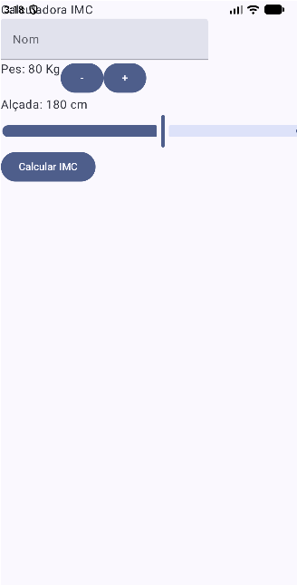
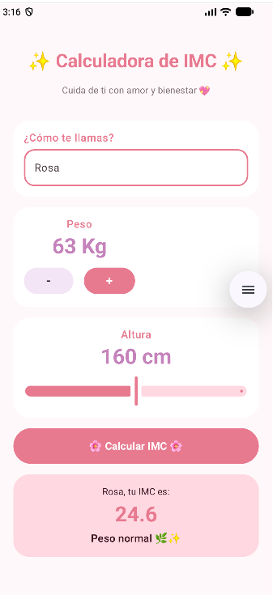

# Calculadora d'IMC

Aplicació Android senzilla desenvolupada amb **Android Studio** i **Jetpack Compose** per calcular l'Índex de Massa Corporal (IMC).
L'usuari pot introduir el seu nom, seleccionar l'alçada, modificar el pes i calcular el seu IMC.

## Funcionalitats

- Introducció del nom de l'usuari.
- Selecció de l'alçada.
- Modificació del pes.
- Càlcul de l'IMC amb la fórmula: **pes / (alçada * alçada)**.
- Visualització del resultat de l'IMC.
- Interfície d'usuari creada amb Jetpack Compose.

## Tecnologies utilitzades

- Kotlin
- Android Studio
- Jetpack Compose
- Gradle

## Ús

1. Escriu el teu nom.
2. Selecciona la teva alçada.
3. Modifica el pes.
4. Prem el botó per calcular l'IMC.
5. Consulta el resultat obtingut.

## Captures de pantalla

## Autora

- **Nom:** Mamen Busquets
- **Github:** https://github.com/MamenBusquets
